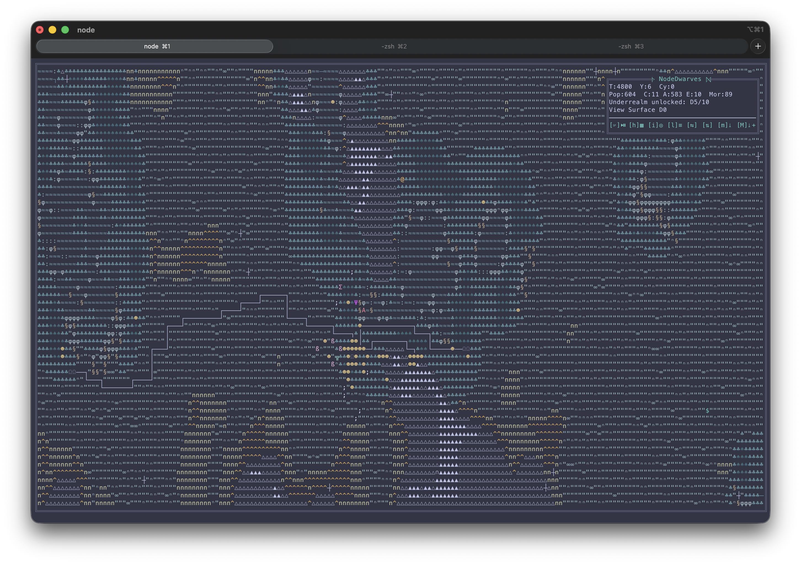
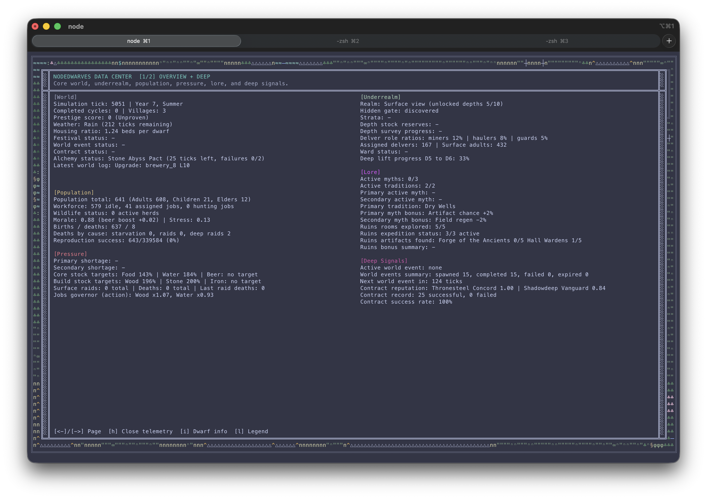
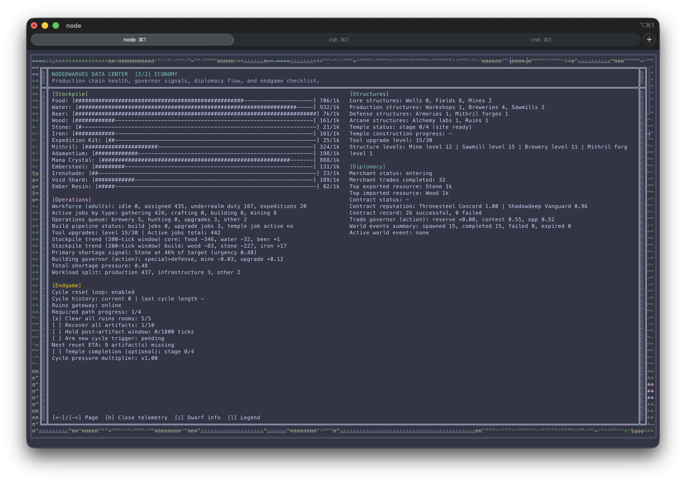

# NodeDwarves 🛠️

NodeDwarves is an autonomous ASCII dwarf-colony simulator that runs entirely in your terminal.
Start a run, watch the settlement react to shortages and crises, and tune the system like a tiny living lab. 🍺⛏️
Chaos, strategy, and tiny bearded logistics experts included. 🧔🧱

Current release: **v2.5.0 - Saved Holds and Scenario Challenges**. 🍺🗺️

## Screenshots 📸





## Highlights ✨

- 🧠 Fully autonomous colony sim: no micromanagement after launch.
- 🏔️ A carved ASCII gatehouse shares the world map's theme and seasonal palette and opens new colonies, configured scenarios and saved holds.
- 🎲 Twelve colony templates range from generous supplies to drought, hunger, overcrowding, raids,
  diplomacy, social strife, early Underrealm exploration, warrior injuries and overlapping crises.
- 💾 Per-colony autosaves, manual saves and backup recovery preserve the colony, its history and its random stream.
- ⛏️ A tight, multi-layer economy: most hands are needed just to keep food and water flowing, idle
  dwarves go where shortages hurt most, and a colony can starve, shrink or die out after bad choices. 💀
- 🌦️ Lean winters, weather, festivals, raids, and world events that shift priorities. Stock up before
  the snow, or watch the larder (and the birth rate) empty out. ❄️
- 🍺 Beer is a luxury, not a water substitute: it costs food, and breweries stop when the cellar is full.
- 🗺️ Every map has its own character: richer or poorer fields and springs, milder or harsher winters, quieter or busier raiders. The same seed always gives the same world.
- 👶 Births are paced: a colony grows at most about a quarter per year (faster while it is small), so generations do not all grow old together. Grow too fast and the springs run dry.
- 🏛️ Without an AI, the Colony Council steers: it holds risky ventures back so labor and food stay home, announces its decrees in the Event Log, and shows its posture in the Colony Report.
- 🎯 The AI is trained on what actually matters: a big, alive colony, few avoidable deaths, full larders and real progress (deeper Underrealm, landmarks, prestige). Promotion is judged over 8,000-tick games, where bad choices have time to bite.
- 🤝 External camps, diplomacy pressure, contracts, and faction trade opportunities.
- 🎭 Social drama + schism systems for long-horizon political and morale instability. Friendships,
  mentorships, rivalries, and grudges leave slow, bounded memories that shape mood and colony climate.
- 🕳️ Underrealm exploration with depth progression, combat pressure, and endgame cadence.
- 🏅 Warrior League with hero progression, tournaments, injuries, and lineage memory.
- 📜 Deterministic structured events preserve who/where/why facts behind the compact terminal log,
  including lifecycle milestones, social incidents, battles, tournament legacies, council decrees,
  ritual transitions, diplomacy, world/culture shifts, construction milestones, relic recovery, and
  cycle passages. The Event Log exposes importance, named actors, place, and saga context without
  abandoning its compact all/drama views; a source audit guards against legacy-only producers.
- 🪪 One shared dwarf identity resolver keeps names, houses, role titles, stable IDs, and historical
  champion snapshots coherent across Inspect, Event Log, Warrior League, and telemetry. Priority
  story messages use names instead of raw dwarf IDs, adding house context only for collisions.
- 🗿 Villages, roads, the Deep Gate, lifts, ruins, and the Ancestor Temple receive deterministic
  names stored with the world. Events, Inspect, and telemetry share those names, with short labels
  ready for cramped terminals.
- 🏺 Completed cycles now leave a bounded world legacy: remembered heroes and holds, memorials,
  inherited institutions, and golden map echoes survive new terrain without copying an old world or
  stacking runaway bonuses.
- ⚑ Raider leaders and encountered Underrealm champions can become deterministic named nemeses.
  Their scars, grudges, and hero encounters remain bounded across events and qualifying cycle
  transitions; surface nemeses can drive readable warning → approach → demand → breach → battle →
  aftermath sieges with guarded losses and visible recovery. Independent deep threats may still
  overlap, because a dwarven epic should occasionally produce a genuinely terrifying bad year. ☠️
- 🏰 Five unique settlement landmarks grow through visible stages: Great Hall, Warrior Arena,
  Legendary Forge, Gate Fortress, and Ancestor Walk. Their reserved footprints blossom into compact
  districts, while construction, prosperity, siege damage, abandonment, and restoration remain
  readable on the live map and exported maps.
- 👁️ When population exceeds the map cap, urgent story actors, endangered dwarves, champions, saga
  protagonists, and recent incident actors keep their place on-screen through a stable RNG-free
  priority selector.
- 🎬 A bounded, deterministic Story Director scores canonical facts by severity, rarity, named cast,
  consequences, saga continuity, and visible map layer. Cooldowns and interruption budgets keep the
  spotlight readable while critical events can preempt weaker focus—with every decision explained.
  Related facts become stable sagas with explicit lifecycles and compact chapters derived only from
  events that actually happened. The Colony Report's Technical page and headless reports expose the current focus,
  current saga, cooldowns, selection reasons, priority coverage, suppression counts, and saga
  outcomes.
- 🎞️ A restrained story-focus overlay highlights involved dwarves and critical locations.
  Follow event and saga context in the Event Log and the Colony Report.
- ⏱️ Explicit controls from `0.5x` through batched `100x`, plus exact single-step, support both close
  observation and rapid endgame trials. Critical beats temporarily slow the visible loop, legendary
  beats briefly hold it, and every accelerated tick still runs the full simulation, AI cadence, and
  endgame checks without changing PPO inputs.
- 🗝️ Late-game relic expeditions remain dangerous but feasible: the maximum D10 loadout can enter the
  warning band, while repeat artifact hunts use a D9 readiness ceiling after the ruins are cleared.
- 📖 Major lived deeds now follow each dwarf as a bounded, source-backed biography. Inspect separates
  witnessed history from inherited lore, while cycle transitions distill seven factual Chronicle
  chapters. Press `c` to export deterministic Markdown and JSON records with source-event trails.
- 🛣️ Completed regional roads guide longer trips toward useful connections, while the starter colony keeps its familiar local routes.
- 🏛️ Witnessed construction can found an inherited Builders' Guild, giving later colonies a small, fading boost to their works.
- 📚 Political sagas follow one bounded arc through local rituals to their witnessed outcome.
- 🌤️ In-map Ops Snapshot shows a live weather token (`Wx:*`, e.g. `Clear`, `Rain`, `Storm`) for at-a-glance climate context.
- 📊 In-game Colony Report (`h`): a GOOD / WATCH / BAD health check where every line says in plain words what it means, a "needs attention" list, Economy, People and Frontier pages, plus a Technical page for AI and Story Director internals.
- 🔬 The Economy page explains what drives the colony right now: food yield x0.44 because of winter, need pace x1.07 because of schism... every economic multiplier has a name and a ceiling.
- 🤖 PPO training pipeline in Python with JS runtime inference (`models/*.json`), a lean ~80-signal
  colony observation, and a self-scaling critic that reports its own health (`ev=`) in the logs.
- 🧪 Deterministic benchmark/regression tooling with a cached baseline, plus a fast in-process scorecard that pits default, careless and trained play against each other.

## Quick Start 🚀

```bash
npm install
npm start
```

Choose **New colony**, **Load colony** or **Continue latest** in the opening menu.
Try the free colony or choose among eleven themed presets, from Green Valley's generous supplies
to The Long Emergency's overlapping crises. Each preset shows its focus and difficulty in the menu.
Press `s` to save; autosave and a final save on Ctrl+C keep each colony in `saves/`.

Skip the menu with `npm start -- --new`, `--seed 101`, `--scenario green_valley`, `--resume`,
`--load saves/COLONY_ID.json` or `--config /path/to/config.json`. `--seed` and `--scenario` start a
new colony; `--ai FILE` picks a policy for it (loaded games keep their own).

| Scenario | Difficulty | Focus |
| --- | --- | --- |
| `free` | Standard | Unrestricted colony, random seed |
| `green_valley` | Gentle | Double founding supplies |
| `lean_provisions` | Challenging | Reduced reserves |
| `dry_stone` | Challenging | Thirst, drought and water gathering |
| `hungry_hills` | Challenging | Hunger, cold and leaner harvests |
| `crowded_hearth` | Challenging | Twenty settlers and costlier housing |
| `raider_frontier` | Hard | Earlier raids and heavier looting |
| `border_council` | Hard | Camps, diplomacy and political pressure |
| `divided_halls` | Hard | Rivalries, grudges and cohesion |
| `below_the_gate` | Hard | Earlier Deep Gate and a faster mining frontier |
| `arena_of_stone` | Hard | Larger tournaments, injuries and training |
| `compound_crisis` | Expert | The Long Emergency: overlapping crises |

💾 Saves live in `saves/`: one checkpoint per colony, autosaved every 600 ticks (and at least 30 s
apart), on `s` and on Ctrl+C, with the previous valid file kept as `.json.bak` and recovered
automatically. Resume with the same game build and Node.js major version for identical replays.

Run with the best trained policy (if available):

```bash
npm run ai:play
```

## Controls 🎮

- ⏯️ `Space`: pause/resume
- 🐢 `[` / `]` 🐇: decrease/increase visible simulation speed (`0.5x`, `1x`, `2x`, `4x`, `5x`, `25x`, `100x`; default `1x` runs five ticks per second)
- 👣 `.`: advance exactly one tick and remain paused
- 💾 `s`: save the current colony
- 🗺️ `l`: legend; arrow keys browse pages when needed
- 🔍 `i`: dwarf inspect panel
- ⚔️ `w`: Warrior League modal
- 📡 `h`: Colony Report (telemetry)
- 🧾 `e`: Event Log modal
- 🔁 `f`: switch Event Log filter
- 📖 `c`: export the latest completed (or current) Chronicle as Markdown + JSON
- ↔️ `←` / `→`: switch telemetry pages (or browse context-specific panels)
- ↕️ `↑` / `↓`: change map depth view (or scroll Event Log)
- 🖼️ `m`: export unlocked layers (PNG + SVG)
- 🏗️ `Shift+M`: export unlocked layers with structures/roads

## AI Training (Optional) 🤖

Bootstrap once, then train and play:

```bash
npm run ai:bootstrap
npm run ai:train:m4pro    # 12-core Apple M4 Pro (npm run ai:train:m4 on a 10-core M4)
npm run ai:play
```

The trainer is PPO with a compact outcome reward 🎯 (a big, living colony, few avoidable deaths, full
larders, real progress) and promotion judged over 8,000-tick games. Add `--fresh` after the profile
when the observation or action shape changes. Other wrapper profiles: `fast`, `quality`,
`quality-mixed`, `m4-balanced`, `full`, `endgame`, `benchmark` (`npm run ai:train -- <profile>`).

🧭 Where the simulation and the AI stand, what was measured and the step plan to improve both live in
[STRATEGY.md](STRATEGY.md), together with the measurement tools in `experiments/`.

## Checks & Benchmarks ⚖️

```bash
npm test                                   # every contract suite (or node scripts/<suite>.js)
npm run bench:candidate -- --set path=value
npm run bench:diff                         # refreshes the cached baseline when the profile changed
npm run ai:validate                        # milestone gate: canonical policy, simulation, regression
npm run ai:validate:weekly
npm run debug:clean
node scripts/audit_config.js --trace <trace.jsonl>   # config audit (see STRATEGY.md, step R)
```

Milestone checks: `node scripts/validate_save_continuity.js` (uninterrupted vs resumed worlds) and
`node scripts/validate_scenarios.js [--only <id>]` (every preset, two seeds). Reports are JSON in
`debug/`; CI bundles identify their run and commit and show skipped phases explicitly.

## Documentation 📚

- [STRATEGY.md](STRATEGY.md): state of the art, evidence, measurement protocol and step plan.
- [AGENTS.md](AGENTS.md): contributor and agent rules.
- `config.json`: authoritative configuration and tunable defaults.

## Project Layout (High Level) 🧱

- `app.js`: terminal application entrypoint.
- `config.json`: gameplay, rendering and training settings.
- `src/simulation/`: colony economy, population, stories, roads and world systems.
- `src/state/`: state creation and terrain generation.
- `src/game_session.js`, `src/session_random.js`, `src/persistence.js`: resumable sessions and save storage.
- `src/render/`, `src/runtime/`, `src/telemetry/`: terminal views, controls and diagnostics.
- `src/ai/` and `ai_server.js`: policy inference, outcome reward and training bridge.
- `scripts/`: tests, benchmarks, validation, map export, CI artifacts and cleanup tools.
- `python/`: PPO training and regression rollout tools.
- `experiments/`: measurement tools for STRATEGY.md 🧪 (outputs in git-ignored `experiments/runs/`).
- `models/`: runtime policies and resumable training metadata.
- `regression/baselines/`: durable model-quality reference profiles.
- `benchmark_cache/`: shared deterministic benchmark baseline.
- `debug/`: current JSON validation and comparison reports.
- `chronicles/`: generated Chronicle exports (git-ignored).
- `saves/`: local colony checkpoints and backups (git-ignored).
- `.cache/`: local promotion-eval cache, rebuilt on demand (git-ignored).
- `.github/workflows/quality_gates.yml`: extended and weekly quality checks.

## Contributing 🤝

PRs are welcome for simulation design, AI quality, and terminal UX.
Start with `AGENTS.md` for standards and `STRATEGY.md` for the current plan and how to measure a change.

## License 📄

MIT
