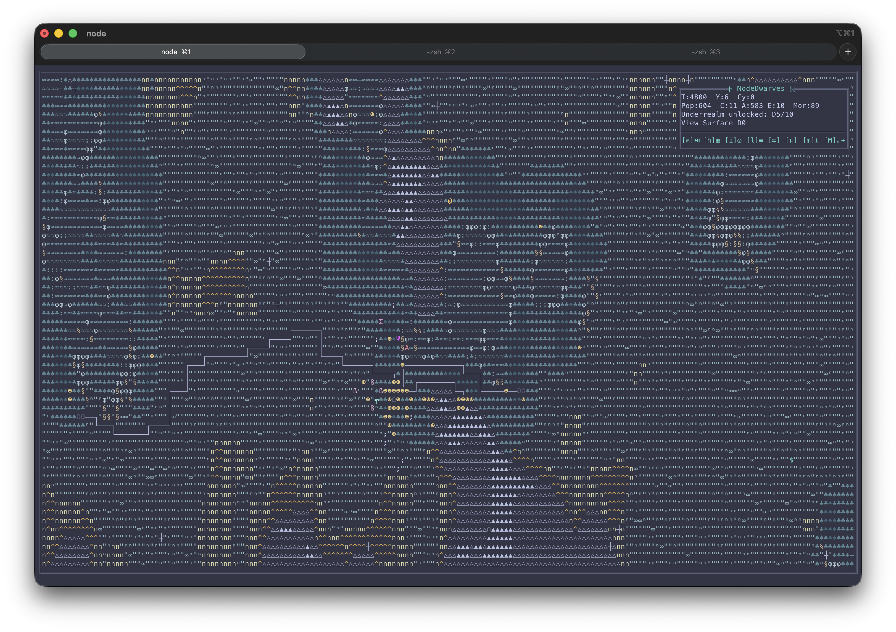
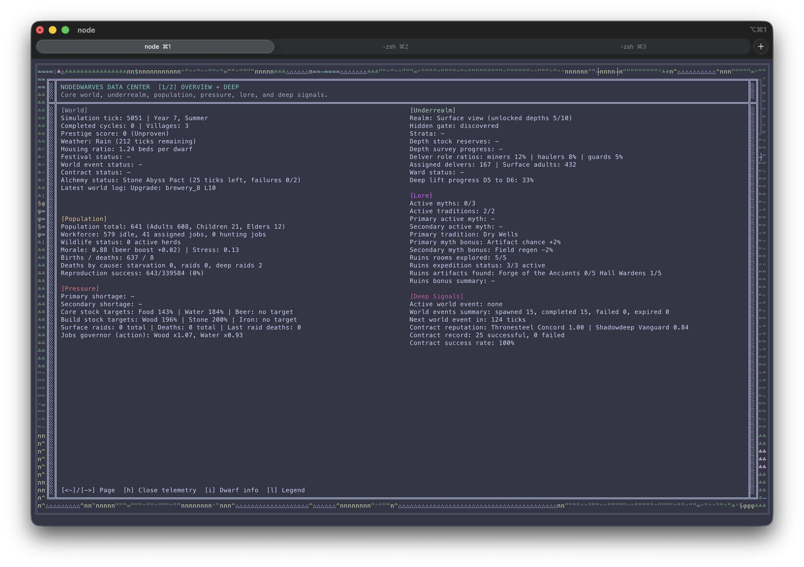
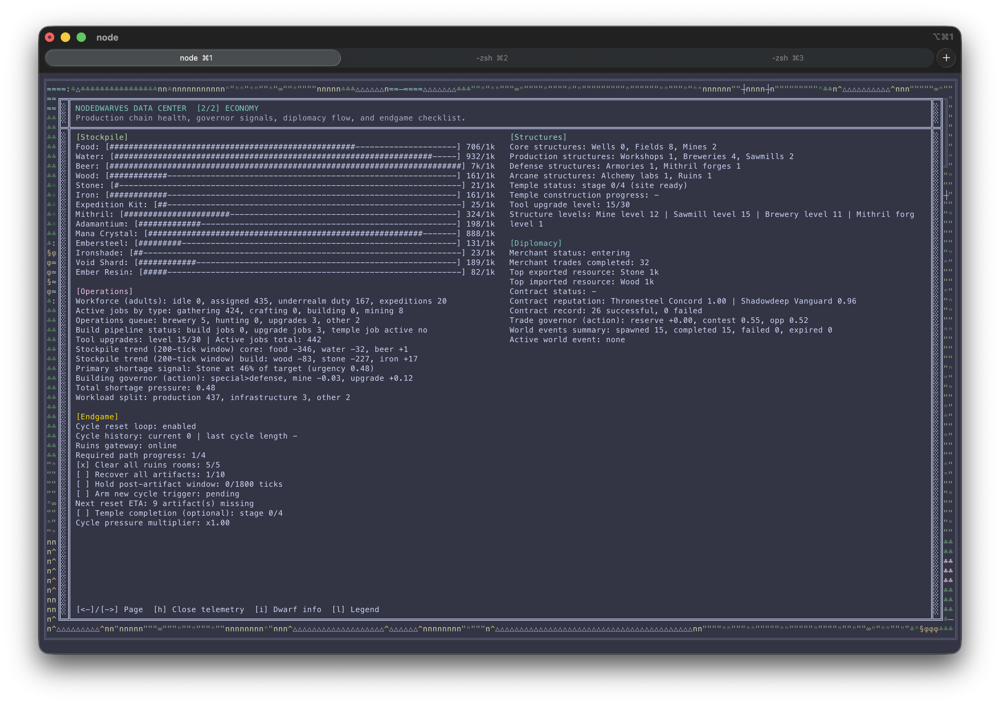

# NodeDwarves 🛠️

NodeDwarves is an autonomous ASCII dwarf-colony simulator that runs entirely in your terminal.
Start a run, watch the settlement react to shortages and crises, and tune the system like a tiny living lab. 🍺⛏️
Chaos, strategy, and tiny bearded logistics experts included. 🧔🧱

Current release: **v2.5.0 - Saved Holds and Scenario Challenges**. 🍺🗺️

## Screenshots 📸





## Highlights ✨

- 🧠 Fully autonomous colony sim: no micromanagement after launch.
- 🏔️ A carved ASCII gatehouse shares the world map's theme and seasonal palette and opens new colonies, configured scenarios and saved holds.
- 🎲 Twelve colony templates range from generous supplies to drought, hunger, overcrowding, raids,
  diplomacy, social strife, early Underrealm exploration, warrior injuries and overlapping crises.
- 💾 Per-colony autosaves, manual saves and backup recovery preserve the colony, its history and its random stream.
- 🔎 Scenario selection previews the actual starting terrain and seed; expand the map with `p` or reroll with `r`.
- 🗺️ Restrained terrain colors keep structures and actors readable. Press `v` for recent, observed
  surface flows, with gathering, work and trade filters.
- ⛏️ Multi-layer economy with gathering, structures, shortages, and recovery loops.
- 🌦️ Seasons, weather, festivals, raids, and world events that shift priorities.
- 🤝 External camps, diplomacy pressure, contracts, and faction trade opportunities.
- 🎭 Social drama + schism systems for long-horizon political and morale instability. Friendships,
  mentorships, rivalries, and grudges leave slow, bounded memories that shape mood and colony climate.
- 🕳️ Underrealm exploration with depth progression, combat pressure, and endgame cadence.
- 🏅 Warrior League with hero progression, tournaments, injuries, and lineage memory.
- 📜 Deterministic structured events preserve who/where/why facts behind the compact terminal log,
  including lifecycle milestones, social incidents, battles, tournament legacies, council decrees,
  ritual transitions, diplomacy, world/culture shifts, construction milestones, relic recovery, and
  cycle passages. The Event Log exposes importance, named actors, place, and saga context without
  abandoning its compact all/drama views; a source audit guards against legacy-only producers.
- 🪪 One shared dwarf identity resolver keeps names, houses, role titles, stable IDs, and historical
  champion snapshots coherent across Inspect, Event Log, Warrior League, and telemetry. Priority
  story messages use names instead of raw dwarf IDs, adding house context only for collisions.
- 🗿 Villages, roads, the Deep Gate, lifts, ruins, and the Ancestor Temple receive deterministic
  names stored with the world. Events, Inspect, and telemetry share those names, with short labels
  ready for cramped terminals.
- 🏺 Completed cycles now leave a bounded world legacy: remembered heroes and holds, memorials,
  inherited institutions, and golden map echoes survive new terrain without copying an old world or
  stacking runaway bonuses.
- ⚑ Raider leaders and encountered Underrealm champions can become deterministic named nemeses.
  Their scars, grudges, and hero encounters remain bounded across events and qualifying cycle
  transitions; surface nemeses can drive readable warning → approach → demand → breach → battle →
  aftermath sieges with guarded losses and visible recovery. Independent deep threats may still
  overlap, because a dwarven epic should occasionally produce a genuinely terrifying bad year. ☠️
- 🏰 Five unique settlement landmarks grow through visible stages: Great Hall, Warrior Arena,
  Legendary Forge, Gate Fortress, and Ancestor Walk. Their reserved footprints blossom into compact
  districts, while construction, prosperity, siege damage, abandonment, and restoration remain
  readable on the live map and exported maps.
- 👁️ When population exceeds the map cap, urgent story actors, endangered dwarves, champions, saga
  protagonists, and recent incident actors keep their place on-screen through a stable RNG-free
  priority selector.
- 🎬 A bounded, deterministic Story Director scores canonical facts by severity, rarity, named cast,
  consequences, saga continuity, and visible map layer. Cooldowns and interruption budgets keep the
  spotlight readable while critical events can preempt weaker focus—with every decision explained.
  Related facts become stable sagas with explicit lifecycles and compact chapters derived only from
  events that actually happened. The Data Center and headless reports expose the current focus,
  current saga, cooldowns, selection reasons, priority coverage, suppression counts, and saga
  outcomes.
- 🎞️ A restrained story-focus overlay highlights involved dwarves and critical locations.
  Follow event and saga context in the Event Log and Data Center.
- ⏱️ Explicit controls from `0.5x` through batched `100x`, plus exact single-step, support both close
  observation and rapid endgame trials. Critical beats temporarily slow the visible loop, legendary
  beats briefly hold it, and every accelerated tick still runs the full simulation, AI cadence, and
  endgame checks without changing PPO inputs.
- 🗝️ Late-game relic expeditions remain dangerous but feasible: the maximum D10 loadout can enter the
  warning band, while repeat artifact hunts use a D9 readiness ceiling after the ruins are cleared.
- 📖 Major lived deeds now follow each dwarf as a bounded, source-backed biography. Inspect separates
  witnessed history from inherited lore, while cycle transitions distill seven factual Chronicle
  chapters. Press `c` to export deterministic Markdown and JSON records with source-event trails.
- 🛣️ Completed regional roads guide longer trips toward useful connections, while the starter colony keeps its familiar local routes.
- 🏛️ Witnessed construction can found an inherited Builders' Guild, giving later colonies a small, fading boost to their works.
- 📚 Political sagas follow one bounded arc through local rituals to their witnessed outcome.
- 🌤️ In-map Ops Snapshot shows a live weather token (`Wx:*`, e.g. `Clear`, `Rain`, `Storm`) for at-a-glance climate context.
- 📊 In-game Data Center (`h`) with dashboard, deep economy views, Story Director visibility, and AI explainability.
- 🤖 PPO training pipeline in Python with JS runtime inference (`models/*.json`).
- 🧪 Deterministic benchmark/regression tooling with cached baseline comparison and milestone measurements for colony habits, travel, and saga coherence.

## Quick Start 🚀

```bash
npm install
npm start
```

Choose **New colony**, **Load colony** or **Continue latest** in the opening menu.
Try the free colony or choose among eleven themed presets, from Green Valley's generous supplies
to The Long Emergency's overlapping crises. Each preset shows its focus and difficulty in the menu.
Press `s` to save; autosave and a final save on Ctrl+C keep each colony in `saves/`.

Skip the menu with `npm start -- --new`, `--scenario green_valley`, or `--resume`.
See the [manual](MANUAL.md) for reproducible seeds and save compatibility.

Run with the best trained policy (if available):

```bash
npm run ai:play
```

## Controls 🎮

- ⏯️ `Space`: pause/resume
- 🐢 `[` / `]` 🐇: decrease/increase visible simulation speed (`0.5x`, `1x`, `2x`, `4x`, `5x`, `25x`, `100x`; default `1x` runs five ticks per second)
- 👣 `.`: advance exactly one tick and remain paused
- 💾 `s`: save the current colony
- 🧭 `v`: cycle surface flow views (off, all, gathering, work, trade)
- 🗺️ `l`: legend; arrow keys browse pages when needed
- 🔍 `i`: dwarf inspect panel
- ⚔️ `w`: Warrior League modal
- 📡 `h`: telemetry Data Center
- 🧾 `e`: Event Log modal
- 🔁 `f`: switch Event Log filter
- 📖 `c`: export the latest completed (or current) Chronicle as Markdown + JSON
- ↔️ `←` / `→`: switch telemetry pages (or browse context-specific panels)
- ↕️ `↑` / `↓`: change map depth view (or scroll Event Log)
- 🖼️ `m`: export unlocked layers (PNG + SVG)
- 🏗️ `Shift+M`: export unlocked layers with structures/roads

## AI Training (Optional) 🤖

Bootstrap once, then train/play:

```bash
npm run ai:bootstrap
npm run ai:train
npm run ai:play
```

Quality-oriented loop and acceptance gate:

```bash
npm run ai:train:m4
npm run ai:train -- quality
npm run ai:validate
npm run audit:narrative-producers
npm run test:narrative
npm test
```

`audit:narrative-producers` reports direct legacy-only event writers. `test:narrative` runs the fast
structured-event contract gate in isolation. `npm test` runs the audit plus narrative and
training/validation contract suites.

CI bundles identify their run and commit, keep fresh evidence, and show skipped phases explicitly.

`ai:train:m4` is the direct shortcut for the `m4-balanced` profile. The generic
`ai:train` command accepts the wrapper profile after `--`: `fast` (default), `quality`,
`quality-mixed`, `m4-balanced`, `full`, `endgame`, or `benchmark`. The
`m4-balanced` profile is the sustainable speed/quality preset for a 10-core,
16 GB Apple M4: quality-mixed foundation/finetune, a dedicated 20,000-tick
endgame specialization phase, `5→4→3` workers, sparse intermediate evaluation,
and one guarded final canonical check. Add `--fresh` after the profile when
observation or action contracts change.

For training profiles, validation and everyday operations, see [MANUAL.md](MANUAL.md).

## Balance & Benchmark Workflow ⚖️

Keep tuning deterministic and comparable:

```bash
npm run bench:ensure-baseline
npm run bench:candidate -- --set path=value
npm run bench:diff
```

Long-running and weekly checks:

```bash
npm run ai:train:continuous
npm run ai:validate
npm run ai:validate:weekly
npm run debug:clean
```

## Documentation 📚

- [MANUAL.md](MANUAL.md): concise user and operator guide.
- [AGENTS.md](AGENTS.md): contributor and agent guidelines.
- `config.json`: authoritative configuration and tunable defaults.

## Project Layout (High Level) 🧱

- `app.js`: terminal application entrypoint.
- `config.json`: gameplay, rendering and training settings.
- `src/simulation/`: colony economy, population, stories, roads and world systems.
- `src/state/`: state creation and terrain generation.
- `src/game_session.js`, `src/session_random.js`, `src/persistence.js`: resumable sessions and save storage.
- `src/render/`, `src/runtime/`, `src/telemetry/`: terminal views, controls and diagnostics.
- `src/render/map_readability.js`, `src/render/map_flows.js`, `src/render/scenario_preview.js`:
  map hierarchy, observed traffic and scenario previews; `src/runtime/map_flows.js` tracks visible activity.
- `src/ai/` and `ai_server.js`: policy inference and training bridge.
- `scripts/`: benchmarks, validation, map export, CI artifacts and cleanup tools.
- `python/`: PPO training and regression rollout tools.
- `models/`: runtime policies and resumable training metadata.
- `regression/baselines/`: durable model-quality reference profiles.
- `benchmark_cache/`: shared deterministic benchmark baseline.
- `debug/`: current operational validation and comparison reports.
- `chronicles/`: generated Chronicle exports (git-ignored).
- `saves/`: local colony checkpoints and previous-generation backups (git-ignored).
- `.github/workflows/quality_gates.yml`: extended and weekly quality checks.

## Contributing 🤝

PRs are welcome for simulation design, AI quality, and terminal UX.
Start with `AGENTS.md` + `MANUAL.md` for implementation standards and workflows.

## License 📄

MIT
